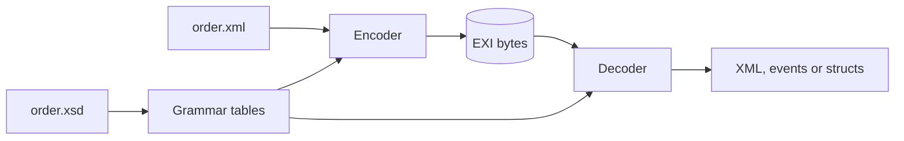

# EXIFormat.jl

EXIFormat turns XML into small, fast binary messages and back, in Julia. This
manual shows you how, one small example at a time.

**EXI** (Efficient XML Interchange) is a W3C standard for sending XML as
compact binary. The order in this guide's examples is 538 bytes of XML and only
129 bytes of EXI.

The trick is that both sides share the XML [schema](@ref "Schema"). Each
side knows which elements and attributes can come next, and what type each
value has. So the stream does not have to spell out names or write numbers as
text.



New to EXI? [Words you'll see](manual/glossary.md) explains the terms in one or two
lines each.

## Installation

EXIFormat needs Julia 1.10 or newer. In the Pkg REPL (press `]`):

```
pkg> add EXIFormat
```

or with `using Pkg; Pkg.add("EXIFormat")`.

## Quick start

```@setup home
#! setup roundtrip.jl
```

```@example home
tables = EXIFormat.compile_files(data("order.xsd"))   # once
xml = read(data("order.xml"), String)
options = EXIFormat.strict_options()
exi = EXIFormat.encode_xml(xml, tables; options)
back = EXIFormat.decode_to_xml(exi, tables; options)
println(sizeof(xml), " bytes of XML became ", length(exi), " bytes of EXI")
```

## What you will learn

Each chapter of the manual follows one small script in `examples/basics`, from easiest to
hardest:

1. **Round trip**: XML to EXI and back in three calls.
2. **Options**: what the header holds, and what changes the size.
3. **Reading events**: walking a stream one piece at a time.
4. **Writing events**: building a document without any XML text.
5. **Structs**: turning your own Julia types into EXI.
6. **Prebuilt tables**: skipping the schema step when your program runs.

Every example has a Rust twin in rexi that prints exactly the same output, so you
can read the two languages side by side.

## What EXIFormat does not do (yet)

EXIFormat works in [strict](@ref "Strict, non-strict"), schema-informed mode
only. That is the most compact form EXI offers. Compression, schema-less
streams, non-strict mode, the "preserve" options (comments, prefixes and so
on) and elements that would need a built-in grammar are refused with a clear
error. EXIFormat never quietly does something close
enough instead.

## Where to go next

- The **Manual** starts with [Getting started](manual/getting-started.md).
- The **API reference** documents every public name, starting with
  [Schemas and tables](api/schemas.md).
- [EXIFormat and rexi side by side](appendix/side-by-side.md) maps each call to
  the Rust version.
