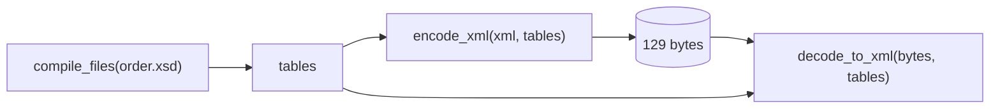

# Your first round trip

In this chapter you'll turn XML text into EXI bytes and back again. It takes
three steps:



```@setup roundtrip
#! setup roundtrip.jl
```

```@example roundtrip
#! include roundtrip.jl main
```

## What to notice

- **Compile the schema once.** `compile_files` makes the
  [grammar tables](@ref "Grammar, grammar tables"). It is the slowest step,
  so keep the tables and reuse them for every document.
- **The decoder needs the same options.** Here the
  [options](@ref "Options") are not written into the stream (that keeps
  it small), so `decode_to_xml` is told them. The next chapter shows the other
  way.
- **Values come back in standard form.** The price `31.50` comes back as
  `31.5`, because EXI stores the number, not the text you typed. The line
  breaks between elements are dropped too. The schema says those elements hold
  only other elements, not text.
